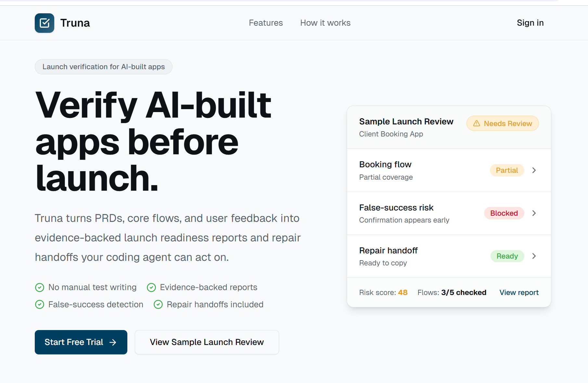

# Truna

**Launch verification for AI-built applications.**

Truna is an AI-assisted launch verification platform I designed, built, and deployed to help builders check critical user flows before release. It turns product requirements into controlled browser checks, collects execution evidence, and produces launch findings and actionable repair handoffs.

**[Open Truna](https://truna-frontend.vercel.app/)** · [Product Workflow](#product-workflow) · [System Architecture](#system-architecture)



## Why I Built Truna

An application can look finished while its signup, booking, checkout, or other important workflows still fail. I built Truna to make those gaps easier to investigate before launch.

The product connects what an application is supposed to do with what its browser execution actually shows. Builders can review test plans, inspect evidence, understand blockers, and hand findings back to a coding agent.

## Product Workflow

1. **Define the application.** Create a project and import a PRD, specification, or product brief.
2. **Review critical flows.** Accept the user journeys that matter for launch.
3. **Approve a verification plan.** Review a bounded browser plan for the target application.
4. **Run browser checks.** Execute the plan with Playwright and collect screenshots, page text, console errors, network activity, and step logs.
5. **Review findings.** Inspect observed outcomes, supporting evidence, false-success risks, and launch blockers.
6. **Hand off repairs.** Generate actionable instructions for a coding agent and use the findings to guide the next iteration.

## Product Capabilities

| Capability | What It Provides |
| --- | --- |
| Requirements to verification | Converts product documents into reviewable critical flows and controlled test plans |
| Browser execution | Runs approved checks with domain, action, step, and runtime limits |
| Evidence collection | Brings screenshots, page content, console output, requests, and execution logs into the review |
| False-success risk analysis | Flags cases where success shown in the interface conflicts with failure signals in execution evidence |
| Launch review | Combines flow-level findings, blockers, and risk analysis into a project-level review |
| Repair handoffs | Produces structured findings for Cursor, Claude Code, Replit, Lovable, and other coding workflows |
| Feedback intake | Turns imported feedback into inputs for further verification |

## System Architecture

Truna connects a web workspace, backend services, a browser runner, and an evidence-analysis workflow.

| Layer | Implementation |
| --- | --- |
| Product interface | Next.js, React, TypeScript, and Tailwind CSS |
| Backend | Express and TypeScript services for projects, flows, verification runs, feedback, and repair handoffs |
| Persistence | Prisma and PostgreSQL for application records and verification jobs |
| Browser runner | Playwright with controlled plans and execution guardrails |
| Analysis | LLM-assisted flow extraction and evidence analysis, structured validation, and risk scoring |
| Access and usage | Workspace ownership, authentication, quotas, and rate limits |

The workflow carries requirements through planning, browser execution, evidence collection, analysis, and repair handoff. Findings stay connected to the evidence collected during a run so builders can inspect the basis for a review.

## My Role

I designed, built, and deployed Truna end-to-end: product concept, frontend workspace, backend APIs, data models, verification planning, Playwright integration, evidence handling, risk analysis, repair handoffs, and deployment configuration.

## Development

Truna is deployed and under active development. Upcoming work includes deeper business-outcome verification for email, payments, and webhooks; richer feedback analysis; team collaboration; and billing integration.

## Source Code and Developer Reference

The application source is maintained privately. This repository provides product documentation, the deployment link, architecture information, and a small independent TypeScript reference example.

<details>
  <summary>Run the TypeScript report example</summary>

[`report-example.ts`](./report-example.ts) uses synthetic evidence to illustrate typed verification reports and a small summarizer. Its report format and logic are independent of the deployed application's production implementation and API.

Run with Node.js 22.18+ or 24+; no dependencies or credentials are needed:

```bash
node report-example.ts
```

The three scenarios cover a failed save despite a success message, a submission without outcome evidence, and an update with confirmed evidence. They produce `blocked`, `needs-review`, and `checks-passed` summaries respectively.

</details>

## Security

See the [security policy](SECURITY.md) and [security and deployment notes](docs/PRODUCTION_SECURITY.md) for reporting guidance and the scope of this public repository.
